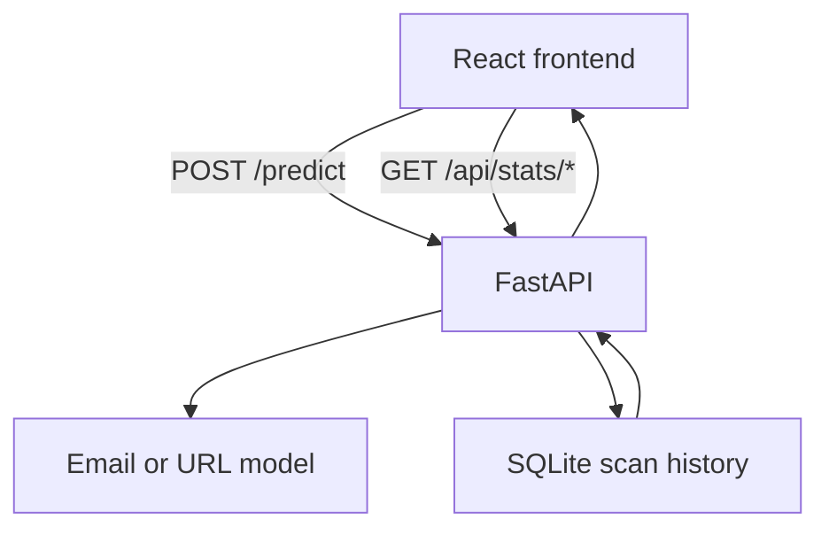

# Email & URL Spam Detection Dashboard

A full-stack coursework project for checking text or URLs against trained classification models and exploring scan statistics. It combines a **React/Vite frontend**, **FastAPI backend**, **scikit-learn models**, and **SQLite-backed scan history**.

The repository contains the application, serialized model files, and the Python data-preparation/training work.

## Features

- **Scan text:** paste an email message or URL, or upload a `.txt` file.
- **View a verdict:** see the model's spam/ham classification and reported probability.
- **Explore trends:** inspect scan counts, spam/ham ratios, trends, and a probability histogram.
- **Review activity:** the home page displays totals and the most recently detected spam.
- **Route inputs:** strings beginning with `http://` or `https://` use the URL classifier; other text uses the email classifier.

> **Educational prototype:** This is not a production phishing or malware detection system. A clean verdict does not establish that a link or message is safe.

## Technology

| Component | Libraries / tools |
| --- | --- |
| Frontend | React, Vite, React Router, Material UI, TanStack Query, D3 |
| Backend | Python, FastAPI, SQLModel / SQLite |
| Classification | scikit-learn, joblib |
| Data and training | Python scripts in `Training/` |

## Architecture



The backend loads the classifiers from `BackEnd/Models/` and stores submitted scans in SQLite. The frontend has three main routes: `/`, `/scan`, and `/stats`.

## Run locally

**Requirements:** Python 3.10+, Node.js, npm, and the supplied `.pkl` files in `BackEnd/Models/`.

### 1. Start the API

From the repository root, create a Python virtual environment:

```bash
cd BackEnd
python -m venv .venv
```

Activate it using the command for your operating system:

```bash
# macOS / Linux
source .venv/bin/activate

# Windows PowerShell (instead of the above)
.venv\Scripts\Activate.ps1
```

Install the backend dependencies and run:

```bash
python -m pip install -r requirements.txt
uvicorn app.main:app --reload --port 8000
```

The API serves <http://localhost:8000/> and interactive docs at <http://localhost:8000/docs>.

### 2. Start the frontend

Open a **second terminal**, starting from the repository root:

```bash
cd FrontEnd
npm ci
npm run dev
```

Visit <http://localhost:5173/>. Vite proxies requests beginning with `/api` to the FastAPI server. The home and statistics pages use `http://localhost:8000` by default, or `VITE_API_BASE` if set.

## API overview

| Endpoint | Purpose |
| --- | --- |
| `GET /` | Backend health response |
| `POST /predict` | Classify text and record the result |
| `GET /api/stats/summary` | Aggregate scan totals |
| `GET /api/stats/latest-spam` | Most recent spam classification |
| `GET /api/stats/timeseries` | Time-bucketed scan statistics |

Additional statistics endpoints are in [`BackEnd/app/stats_api.py`](BackEnd/app/stats_api.py).

## Repository layout

```text
BackEnd/
  app/          FastAPI routes, inference, database, statistics
  Models/       Serialized email and URL models
FrontEnd/
  src/pages/    Home, Scan, Stats
  src/dataVis/  D3 visualizations
Training/       Dataset preparation and model-training scripts
```

## Limitations and responsible use

- URL detection is based on the literal `http://` or `https://` prefix.
- Predictions and confidence figures are model outputs, not guarantees. Independent validation is needed before making reliability claims.
- If a model cannot be loaded, the current backend returns a `Ham` / zero-probability fallback; **that does not mean the input was verified safe**.
- Scan text is saved in SQLite. Do not submit confidential emails to an untrusted deployment.
- Only load trusted `joblib` / pickle model files.
- Review training-data provenance and redistribution rights before republishing datasets elsewhere.
